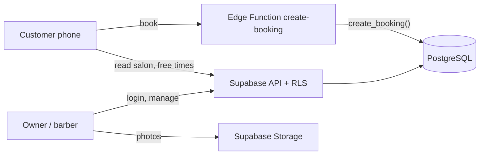

# Navbatly

**Online appointment booking for barbershops and beauty salons in Uzbekistan.**
A customer opens the salon's link (from Instagram or Telegram), picks a service, a barber and a
free time, and books in under a minute — no account needed. The salon owner manages services,
barbers, working hours, days off, photos and bookings from an admin panel. UI in Uzbek (Latin),
ready for Russian.

|                            |                                         |
| -------------------------- | --------------------------------------- |
| **Live demo**              | https://navbatly.vercel.app             |
| **Book at the demo salon** | https://navbatly.vercel.app/b/demo      |
| **Admin panel**            | https://navbatly.vercel.app/admin/login |

### Demo login

**Demo login: available on request.** Two roles exist: the **salon owner** (sees everything) and a
**barber** (sees only his own bookings — enforced by the database, not just the UI).

> The demo uses **fake data only** (customers are "Test mijoz", phones `+998 90 000 00 XX`).
> Bookings made on the demo page appear in the admin panel within a minute.

## Screenshots

**Public booking page** (phone) — real demo data:

| 1. Service + «Ishlarimiz» gallery                        | 2. Barber (nearest free time)                         | 3. Day + free times                               |
| -------------------------------------------------------- | ----------------------------------------------------- | ------------------------------------------------- |
|  |  |  |

**Admin panel** (desktop):

| Bookings (confirm / cancel)                          | Barbers with photos                          |
| ---------------------------------------------------- | -------------------------------------------- |
|  |  |


## What works today

**Customers (no login)** — `/b/:slug`

- 4 steps + confirmation: service → barber → day & time → name/phone; phone's **Back** button
  goes to the previous step; after booking, Back starts a new booking (no double submit).
- Only **really free** times are shown (working hours, lunch, days off, existing bookings,
  minimum notice, booking horizon — calculated in the database).
- If someone takes the time a second earlier: **"Bu vaqt band bo'lib qoldi"** sheet with the
  nearest free times; the form stays filled in.
- Salon cover, logo, barber photos, optional service photos, «Ishlarimiz» gallery with a viewer.

**Owner / barber (admin)** — `/admin`

- Bookings list: search by name/phone, today / tomorrow / 7 days / all, status and barber
  filters, **confirm** and **cancel with reason**. Barbers see only their own bookings.
- Services (price, duration, active switch, optional photo), barbers (profile, services,
  weekly hours with lunch breaks, days off, round photo the owner crops, consent note).
- Settings: salon details, booking rules (time step, horizon, notice, max bookings per phone,
  auto-confirm), salon-wide closed days, cover/logo/gallery photos.
- Settings changes **never change existing bookings** — the owner is warned how many future
  bookings are affected ("Yangi ish vaqtidan tashqarida 2 ta yozilish bor").

## How it stays correct and safe

- **Double booking is impossible:** a PostgreSQL `EXCLUDE` constraint on (barber, time range)
  rejects overlaps even when two customers press "Band qilish" in the same millisecond —
  proven by a real parallel test (`npm run db:test:race`).
- **Row Level Security on every table:** salon A can never read salon B; barbers see only their
  own bookings; inactive barbers/salons lose access. 193 database tests (pgTAP).
- **Customers never write to tables directly:** bookings go through the `create-booking` Edge
  Function → `create_booking()` database function, which re-checks every rule, limits active
  bookings per phone and requests per (hashed) IP, and computes the price and end time itself.
- **Photos:** resized and compressed **in the browser** (WebP, JPEG fallback, GPS data removed)
  before upload; Storage rules allow uploads only into the owner's own salon folder; 5 MB and
  JPEG/PNG/WebP are enforced by Supabase.
- All times stored in UTC, shown in the salon's timezone (`Asia/Tashkent`).

## Tech stack

| Layer    | Technology                                                                                                                                                      |
| -------- | --------------------------------------------------------------------------------------------------------------------------------------------------------------- |
| Frontend | React 19 + TypeScript, Vite 8, React Router, TanStack Query, react-hook-form + zod, Tailwind CSS 4 + shadcn/ui, i18next (Uzbek, Russian-ready), react-easy-crop |
| Backend  | Supabase: PostgreSQL (RLS, `EXCLUDE` constraints, SQL functions), Auth, Storage, Edge Functions (Deno)                                                          |
| Hosting  | Vercel (frontend), Supabase cloud (database, functions, storage)                                                                                                |
| Quality  | pgTAP (193 DB tests), Vitest + Testing Library (125 tests), Playwright (live-site render check, real-Chrome image pipeline check), oxlint, Prettier             |



Full design, decisions and roadmap: **[docs/ARCHITECTURE.md](docs/ARCHITECTURE.md)**.

## Run locally

```bash
npm install
cp .env.example .env.local      # fill in VITE_SUPABASE_URL + VITE_SUPABASE_PUBLISHABLE_KEY
npm run dev                     # http://localhost:5173  (phone on Wi-Fi: npm run dev -- --host)
```

| Command                                      | What it does                                                            |
| -------------------------------------------- | ----------------------------------------------------------------------- |
| `npm test`                                   | Frontend tests (Vitest)                                                 |
| `npm run typecheck` · `npm run lint`         | TypeScript · oxlint                                                     |
| `npm run db:test`                            | Database tests (pgTAP, always rolled back)                              |
| `npm run db:test:race`                       | Two parallel bookings for the same slot → exactly one succeeds          |
| `npm run db:test -- --with-migration <file>` | Dry-run an unapplied migration with all tests                           |
| `npm run check:images`                       | Photo processing checked in real Chrome                                 |
| `npm run check:live`                         | Opens the live site (desktop + phone) and fails on errors / blank pages |
| `npm run db:push` · `npm run db:types`       | Apply migrations · regenerate DB types                                  |

Database changes live only in `supabase/migrations/` (9 migrations), never in the dashboard.

## Next steps

> **No custom domain or email server is planned.** The app runs on `navbatly.vercel.app`.
> "Forgot password" stays switched off (`VITE_PASSWORD_RESET_ENABLED=false`); the platform admin
> resets passwords in the Supabase dashboard (Authentication → Users).

| Next                                   | Why                                                                                           |
| -------------------------------------- | --------------------------------------------------------------------------------------------- |
| **Telegram notifications** (M6)        | "Botni ulash" one-tap linking; a message to the salon for every new online booking.           |
| **Captcha** (M7, Cloudflare Turnstile) | The booking form has a honeypot + database limits today; captcha stops scripted spam.         |
| **Day calendar** in the admin          | Approved mockup exists (`design/03-admin.html`): barbers as columns, tap a free slot to book. |
| **Manual booking** by the owner        | For phone calls and walk-ins (database function already exists).                              |
| **Landing page** (M8)                  | Approved mockup `design/04-landing.html`.                                                     |
| Later                                  | Russian UI, reminders, "any free barber", Telegram Mini App, public salon catalog.            |

Photos: free [Pexels](https://www.pexels.com/license/) images, credited in
[docs/IMAGE_CREDITS.md](docs/IMAGE_CREDITS.md).
