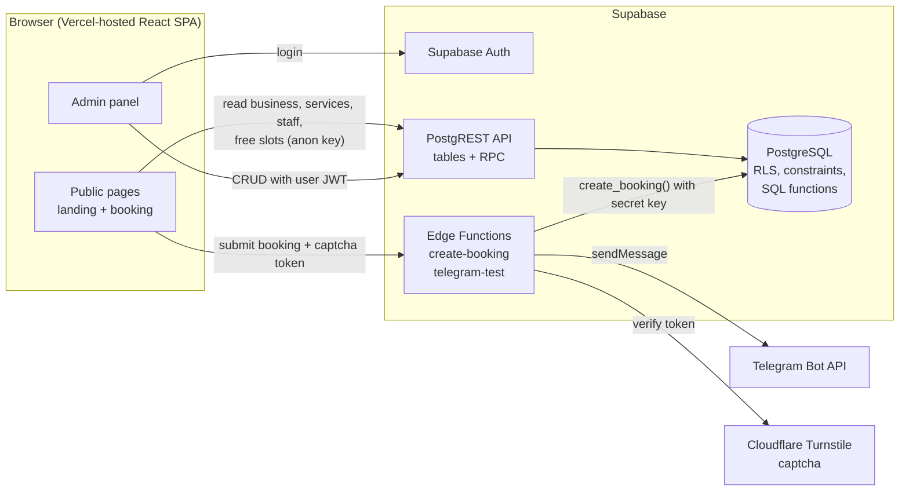
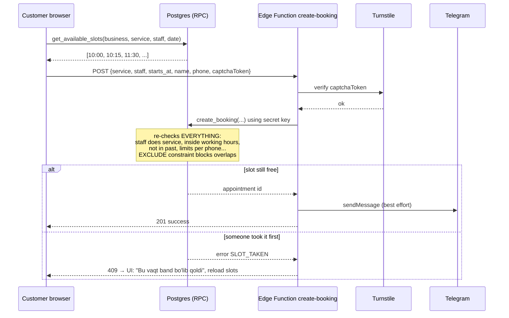
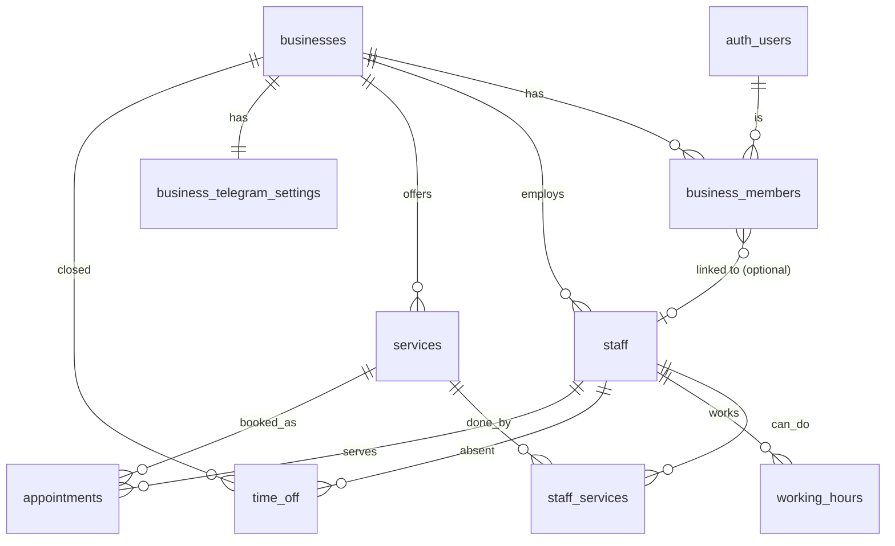

# NAVBATLY — Architecture & MVP Plan

> **Status:** APPROVED v1.0 (2026-11-11). Decisions recorded in §9.
> **Date:** 2026-11-11
> **Product:** Appointment booking and management for barbershops and beauty salons in Uzbekistan.

---

## 0. TL;DR — the 10 most important decisions

| #   | Decision                                                                                                          | Why (in simple terms)                                                                                                                                  |
| --- | ----------------------------------------------------------------------------------------------------------------- | ------------------------------------------------------------------------------------------------------------------------------------------------------ |
| 1   | **Double booking is blocked by a PostgreSQL `EXCLUDE` constraint** on `(staff_id, time range)`                    | The database itself refuses two overlapping bookings, even if two customers click "Book" in the same millisecond. Frontend checks alone can't do that. |
| 2   | **Customers never write to tables directly.** Booking goes through an Edge Function → a database function.        | We can check the captcha, rate limits and business rules in one trusted place. The browser is never trusted.                                           |
| 3   | **Every business table has `business_id`** and RLS checks it.                                                     | One database can safely hold many businesses. A barber from shop A can never see shop B's data.                                                        |
| 4   | **All times are stored as `timestamptz` (UTC)** and shown in `Asia/Tashkent`.                                     | No confusion when a server, a browser or a phone is in another time zone.                                                                              |
| 5   | **Working hours are stored as local time + weekday** (e.g. Mon 09:00–19:00).                                      | That's how a salon owner thinks. We convert to real timestamps only when calculating free slots.                                                       |
| 6   | **Available slots are calculated inside the database** (SQL function).                                            | One source of truth, same logic for UI and for the final booking check.                                                                                |
| 7   | **Telegram is sent from an Edge Function**, the bot token lives only in Supabase secrets.                         | Secrets must never reach the browser.                                                                                                                  |
| 8   | **Feature-based frontend folders** + TanStack Query + react-hook-form + zod + i18next.                            | Easy to find code, easy to add Russian later, standard tools with good docs for beginners.                                                             |
| 9   | **No deletes for appointments** — only status changes (`cancelled`). Services/staff are deactivated, not deleted. | History stays correct; foreign keys never break.                                                                                                       |
| 10  | **Database changes only through migration files in git** (Supabase CLI).                                          | You can rebuild the database anytime, and dev/prod stay identical.                                                                                     |

---

## 1. Requirements analysis

### 1.1 Confirmed MVP scope (from your brief)

- Public landing page.
- Public booking: service → staff → date/time → name + phone. No customer accounts.
- Admin login (Supabase Auth), only owners/staff.
- Admin: appointments (list + calendar), confirm/cancel; manage services, staff, working hours.
- Telegram notification to admin on new booking.
- Double booking prevented at database level.
- Timezone `Asia/Tashkent`; UI in Uzbek (Latin), i18n-ready for Russian.
- Multi-tenant-ready schema (`business_id` + RLS). No self-signup, subscriptions, payments.

### 1.2 Missing or unclear requirements — with my proposed default

These are things the brief does not say, but the code must decide. I propose a default for each; **you only need to answer the ones where you disagree.**

| #   | Topic                              | Question                                                                                                                                                    | Proposed MVP default                                                                                                                                                          |
| --- | ---------------------------------- | ----------------------------------------------------------------------------------------------------------------------------------------------------------- | ----------------------------------------------------------------------------------------------------------------------------------------------------------------------------- |
| R1  | **Landing page purpose**           | Is `/` a marketing page for Navbatly (for salon owners), or a page for one salon?                                                                           | Navbatly marketing page + "Demo" button that opens a demo barbershop's booking page + Telegram contact link (no lead form → no spam surface).                                 |
| R2  | **Business URL**                   | How do customers reach a specific salon?                                                                                                                    | `navbatly.uz/b/{slug}`, e.g. `/b/barber-house`. Owner shares this link on Instagram/Telegram.                                                                                 |
| R3  | **Onboarding**                     | No self-signup — who creates businesses and owner accounts?                                                                                                 | You (platform admin) create them manually: a documented SQL/seed script + Supabase dashboard "Invite user".                                                                   |
| R4  | **Confirmation mode**              | Does a new booking start as `pending` (owner confirms) or `confirmed` automatically?                                                                        | Per-business setting `auto_confirm` (default **false** → `pending`).                                                                                                          |
| R5  | **Does `pending` block the slot?** | —                                                                                                                                                           | **Yes.** Pending and confirmed both block. Only `cancelled` frees the slot.                                                                                                   |
| R6  | **Staff login**                    | Does every staff member log in? What may staff do?                                                                                                          | Login is **optional** per staff member. A staff user sees and confirms/cancels **only their own** appointments. Only owners manage services, staff, hours, settings.          |
| R7  | **"Any available master"**         | Can a customer skip choosing a staff member?                                                                                                                | **Not in MVP** (adds complexity to slot logic). Planned for v1.1.                                                                                                             |
| R8  | **Admin-created bookings**         | Barbershops get many phone calls and walk-ins. Can admin add a booking manually?                                                                            | **Yes, include it** (cheap: same database function, `source = 'admin'`). Strongly recommended — without it the calendar doesn't reflect reality.                              |
| R9  | **Rescheduling**                   | Can admin move an appointment?                                                                                                                              | MVP: cancel + create new. Drag-and-drop reschedule in v1.1.                                                                                                                   |
| R10 | **Customer cancellation**          | Customer has no account — how do they cancel?                                                                                                               | MVP: they call/write the salon. v1.1: secret "manage booking" link.                                                                                                           |
| R11 | **Breaks, days off, holidays**     | Lunch breaks? Vacation? Bayram (holiday) closures?                                                                                                          | Breaks = multiple working intervals per day (09:00–13:00, 14:00–19:00). Add a small **`time_off`** table for vacations / closed days.                                         |
| R12 | **Booking rules**                  | Slot step? How far ahead? Minimum notice?                                                                                                                   | Per business: slot step **15 min**, horizon **30 days**, min notice **60 min**.                                                                                               |
| R13 | **Service options**                | Buffer time after service? Different price/duration per staff? Several services in one booking?                                                             | All **out of MVP**. One booking = one service, same price/duration for all staff.                                                                                             |
| R14 | **Telegram target**                | Owner's personal chat, a group, or per-staff chats? How is the chat linked?                                                                                 | One chat per business (personal or group). MVP: owner pastes `chat_id` in Settings + "Send test message" button. v1.1: one-click linking via `t.me/NavbatlyBot?start=<code>`. |
| R15 | **Telegram events**                | Only new bookings?                                                                                                                                          | MVP: new **online** bookings only (not admin-created ones).                                                                                                                   |
| R16 | **Phone format**                   | Only Uzbek numbers?                                                                                                                                         | Only `+998` numbers, stored normalized as `+998XXXXXXXXX`.                                                                                                                    |
| R17 | **Booking limits per customer**    | Can one phone number book 20 slots?                                                                                                                         | Max **3 active future bookings** per phone per business.                                                                                                                      |
| R18 | **Statuses**                       | `completed`, `no_show`?                                                                                                                                     | MVP: `pending`, `confirmed`, `cancelled`. Past confirmed ones are simply shown as "past". Add `completed`/`no_show` in v1.1 (enum can be extended).                           |
| R19 | **Business content language**      | Service names in Uzbek only, or also Russian?                                                                                                               | MVP: business enters names in one language (plain text). UI strings are fully translatable. Translated content columns later if needed.                                       |
| R20 | **Password reset**                 | —                                                                                                                                                           | Yes, standard Supabase "forgot password" email flow.                                                                                                                          |
| R21 | **Consent**                        | Customer agrees to personal data processing?                                                                                                                | Required checkbox on the booking form + short privacy page.                                                                                                                   |
| R22 | **Devices**                        | —                                                                                                                                                           | **Mobile-first.** Most customers open the link from Instagram/Telegram's in-app browser on a phone.                                                                           |
| R23 | **Legal ⚠️**                       | Uzbekistan's personal data law requires citizens' personal data to be stored on servers **physically located in Uzbekistan**. Supabase is not hosted there. | Fine for a **portfolio/demo** project. Before real commercial use, verify with a lawyer and plan local hosting (e.g. self-hosted Supabase/Postgres in a UZ data center).      |
| R24 | **Data retention**                 | How long do we keep customer names/phones?                                                                                                                  | Keep for MVP; document a future cleanup job (e.g. anonymize after 12 months).                                                                                                 |

---

## 2. Application architecture

### 2.1 Big picture



**In simple words:**

- The React app is just static files on Vercel. It has **no secrets**.
- For **reading** public data and for the **admin panel**, the app talks directly to Supabase. RLS decides what each user may see.
- For **creating a public booking**, the app calls an **Edge Function** (a small server-side TypeScript function). It checks the captcha, then asks the database to create the booking. Then it sends the Telegram message.

### 2.2 Folder structure

```
navbatly/
├── docs/
│   ├── ARCHITECTURE.md          ← this file
│   └── ONBOARDING_BUSINESS.md   ← how to add a new salon manually (later)
├── supabase/
│   ├── config.toml
│   ├── migrations/              ← every DB change, in order (SQL files)
│   │   ├── <timestamp>_extensions_and_types.sql
│   │   ├── <timestamp>_core_tables.sql
│   │   ├── <timestamp>_constraints_indexes.sql
│   │   ├── <timestamp>_rls_helpers_and_policies.sql
│   │   └── <timestamp>_booking_functions.sql
│   ├── functions/               ← Edge Functions (Deno/TypeScript)
│   │   ├── _shared/             ← cors.ts, telegram.ts, turnstile.ts, supabaseAdmin.ts
│   │   ├── create-booking/
│   │   └── telegram-test/
│   ├── tests/                   ← pgTAP tests (RLS + double booking)
│   └── seed.sql                 ← demo barbershop for development
├── public/
├── src/
│   ├── main.tsx
│   ├── app/                     ← app shell: router, providers, layouts
│   │   ├── router.tsx
│   │   ├── providers.tsx        ← QueryClient, i18n, auth provider
│   │   └── layouts/             ← PublicLayout, AdminLayout
│   ├── pages/                   ← thin route components (compose features)
│   │   ├── public/              ← LandingPage, BusinessBookingPage, NotFoundPage, PrivacyPage
│   │   └── admin/               ← LoginPage, AppointmentsPage, CalendarPage, ServicesPage, ...
│   ├── features/                ← real logic, grouped by domain
│   │   ├── auth/                ← useSession, RequireAuth, login form
│   │   ├── business/            ← current business context, settings form
│   │   ├── booking/             ← public wizard steps, slot picker, api.ts
│   │   ├── appointments/        ← list, calendar, status actions, manual booking
│   │   ├── services/
│   │   ├── staff/
│   │   └── schedule/            ← working hours editor, time off
│   │   (each feature: components/, hooks/, api.ts, schemas.ts, types.ts)
│   ├── components/
│   │   ├── ui/                  ← shadcn/ui generated components (don't edit heavily)
│   │   └── common/              ← PageHeader, EmptyState, ErrorState, PhoneInput, ...
│   ├── lib/
│   │   ├── supabase.ts          ← single Supabase client
│   │   ├── datetime.ts          ← ALL timezone helpers (Asia/Tashkent)
│   │   ├── phone.ts             ← normalize/format +998 numbers
│   │   ├── money.ts             ← UZS formatting ("120 000 so'm")
│   │   └── utils.ts             ← cn() etc.
│   ├── i18n/
│   │   ├── index.ts             ← i18next setup
│   │   └── locales/
│   │       ├── uz/              ← common.json, booking.json, admin.json, errors.json
│   │       └── ru/              ← empty for now, same file names later
│   ├── types/
│   │   └── database.types.ts    ← GENERATED by `supabase gen types` — never hand-edit
│   └── styles/globals.css
├── .env.example                 ← lists variable NAMES only, no values
├── .gitignore                   ← includes .env*, except .env.example
└── package.json
```

**Rule of thumb:** `pages/` decide _which_ screen; `features/` contain _how_ it works; `components/` are reusable building blocks; `lib/` has pure helpers with no React.

### 2.3 Main libraries (to install in Milestone 0 — not now)

| Need                                | Library                                | Why                                                          |
| ----------------------------------- | -------------------------------------- | ------------------------------------------------------------ |
| Routing                             | `react-router`                         | Standard, simple.                                            |
| Server data (fetch, cache, refetch) | `@tanstack/react-query`                | Handles loading/error/caching so you don't write it by hand. |
| Forms + validation                  | `react-hook-form` + `zod`              | zod schemas also give TypeScript types.                      |
| i18n                                | `i18next` + `react-i18next`            | Adding Russian = adding JSON files.                          |
| Dates & timezone                    | `date-fns` + `@date-fns/tz`            | Small, explicit timezone support.                            |
| UI                                  | Tailwind + shadcn/ui                   | As requested.                                                |
| Captcha                             | Cloudflare Turnstile widget            | Free, privacy-friendly, works in in-app browsers.            |
| Tests                               | Vitest, pgTAP (DB), Playwright (later) |                                                              |

No global state library (Redux/Zustand) needed: server data lives in React Query, wizard state lives in the booking component.

### 2.4 Data flows

**A. Public visitor opens `/b/barber-house`**

1. App reads `businesses` by `slug` (anon key; RLS allows only active businesses).
2. App reads active `services`, active `staff`, and `staff_services` for this business.

**B. Public booking (the critical flow)**



**C. Admin**

1. Login with email + password (Supabase Auth) → app gets a JWT.
2. App loads `business_members` for the user → knows `business_id` and role (`owner`/`staff`).
3. All queries go directly to tables; RLS filters by `business_id` and role.
4. Status changes (confirm/cancel) and manual bookings go through RPC functions (so rules can't be bypassed).

### 2.5 Time handling (very important — read once carefully)

- **Database:** appointment times are `timestamptz` → stored in UTC.
- **Working hours:** `weekday` (1 = Monday … 7 = Sunday, ISO) + `start_time`/`end_time` as plain `time` = "wall clock in the salon".
- **Converting:** only inside SQL, with `AT TIME ZONE businesses.timezone` (default `'Asia/Tashkent'`).
- **Frontend:** always format with the **business** timezone, never the browser's. All of this lives in `src/lib/datetime.ts` so nobody calls `new Date().getHours()` in components.
- Uzbekistan has no daylight saving time (always UTC+5), which makes bugs rarer — but we still do it correctly so the code works for any future market.

### 2.6 i18n approach

- No hard-coded Uzbek text in components; always `t('booking.chooseService')`.
- Namespaces: `common`, `booking`, `admin`, `errors`.
- Database/Edge Function errors return **codes** (`SLOT_TAKEN`, `TOO_MANY_BOOKINGS`), the frontend translates them.
- Dates/money via `Intl` with locale `uz-Latn-UZ` (later `ru-RU`).
- Language stored in `localStorage`; no `/ru/` URL prefix in MVP.

---

## 3. Database schema

### 3.1 Entity diagram



### 3.2 Extensions and types

- `btree_gist` — needed so the `EXCLUDE` constraint can compare `staff_id` (uuid) with `=` and time ranges with `&&` (overlaps).
- Enum `member_role`: `owner`, `staff`.
- Enum `appointment_status`: `pending`, `confirmed`, `cancelled`.
- Enum `appointment_source`: `online`, `admin`.
- Custom range type `timerange` (range over `time`) — used to stop overlapping working-hour intervals.

### 3.3 Tables

Common columns on every table: `id uuid PK default gen_random_uuid()`, `created_at timestamptz default now()`, `updated_at timestamptz` (maintained by a trigger).

#### `businesses`

| Column                        | Type     | Rules                                   |
| ----------------------------- | -------- | --------------------------------------- |
| name                          | text     | 2–100 chars                             |
| slug                          | text     | **unique**, `^[a-z0-9-]{3,40}$`         |
| phone                         | text     | nullable, `+998` format                 |
| address                       | text     | nullable, ≤ 200                         |
| timezone                      | text     | default `'Asia/Tashkent'`               |
| default_locale                | text     | default `'uz'`, check in (`uz`,`ru`)    |
| slot_step_minutes             | smallint | default 15, check in (5,10,15,20,30,60) |
| booking_horizon_days          | smallint | default 30, 1–90                        |
| min_notice_minutes            | smallint | default 60, 0–1440                      |
| max_active_bookings_per_phone | smallint | default 3                               |
| auto_confirm                  | boolean  | default false                           |
| is_active                     | boolean  | default true                            |

#### `business_members` — who can log in to which business

| Column      | Type                 | Rules                                                    |
| ----------- | -------------------- | -------------------------------------------------------- |
| business_id | uuid FK → businesses |                                                          |
| user_id     | uuid FK → auth.users | on delete cascade                                        |
| role        | member_role          |                                                          |
| staff_id    | uuid FK → staff      | nullable; links a staff login to their staff profile     |
|             |                      | **unique (business_id, user_id)**, **unique (staff_id)** |

> Why separate from `staff`? A _staff profile_ is someone customers can book. A _member_ is someone who can log in. A barber may have no login; an owner may not cut hair. Two different ideas → two tables.

#### `staff` — bookable people

| Column      | Type     | Rules                                       |
| ----------- | -------- | ------------------------------------------- |
| business_id | uuid FK  |                                             |
| full_name   | text     | 2–80                                        |
| photo_url   | text     | nullable (Supabase Storage later)           |
| bio         | text     | nullable, ≤ 300                             |
| is_active   | boolean  | default true (deactivate instead of delete) |
| sort_order  | smallint | default 0                                   |
|             |          | **unique (id, business_id)** — see 3.4      |

#### `services`

| Column           | Type     | Rules                        |
| ---------------- | -------- | ---------------------------- |
| business_id      | uuid FK  |                              |
| name             | text     | 2–80                         |
| description      | text     | nullable, ≤ 300              |
| duration_minutes | smallint | 5–480                        |
| price_uzs        | integer  | ≥ 0 (whole so'm)             |
| is_active        | boolean  | default true                 |
| sort_order       | smallint | default 0                    |
|                  |          | **unique (id, business_id)** |

#### `staff_services` — which staff can do which service

| Column      | Type | Rules                                   |
| ----------- | ---- | --------------------------------------- |
| business_id | uuid |                                         |
| staff_id    | uuid | FK (staff_id, business_id) → staff      |
| service_id  | uuid | FK (service_id, business_id) → services |
|             |      | **PK (staff_id, service_id)**           |

#### `working_hours` — weekly template

| Column      | Type     | Rules                                                          |
| ----------- | -------- | -------------------------------------------------------------- |
| business_id | uuid     |                                                                |
| staff_id    | uuid     | FK (staff_id, business_id) → staff, on delete cascade          |
| weekday     | smallint | 1–7 (ISO, 1 = Monday)                                          |
| start_time  | time     |                                                                |
| end_time    | time     | check `end_time > start_time`                                  |
|             |          | **EXCLUDE** overlapping intervals for the same staff + weekday |

A lunch break = two rows for the same day. A day off = no rows for that day.

#### `time_off` — vacations, sick days, holidays

| Column             | Type        | Rules                                                    |
| ------------------ | ----------- | -------------------------------------------------------- |
| business_id        | uuid        |                                                          |
| staff_id           | uuid        | **nullable** → `NULL` means the whole business is closed |
| starts_at, ends_at | timestamptz | check `ends_at > starts_at`                              |
| reason             | text        | nullable, ≤ 200                                          |

#### `appointments`

| Column            | Type               | Rules                                                                           |
| ----------------- | ------------------ | ------------------------------------------------------------------------------- |
| business_id       | uuid               |                                                                                 |
| staff_id          | uuid               | FK (staff_id, business_id) → staff, **on delete restrict**                      |
| service_id        | uuid               | FK (service_id, business_id) → services, **on delete restrict**                 |
| starts_at         | timestamptz        |                                                                                 |
| ends_at           | timestamptz        | **calculated by the server** from service duration; check `ends_at > starts_at` |
| status            | appointment_status | default `pending`                                                               |
| source            | appointment_source | `online` / `admin`                                                              |
| customer_name     | text               | 2–80                                                                            |
| customer_phone    | text               | check `^\+998[0-9]{9}$`                                                         |
| customer_note     | text               | nullable, ≤ 300                                                                 |
| price_uzs         | integer            | **snapshot** of price at booking time                                           |
| status_changed_at | timestamptz        | nullable                                                                        |
| status_changed_by | uuid → auth.users  | nullable (who confirmed/cancelled)                                              |
| cancel_reason     | text               | nullable, ≤ 200                                                                 |
| created_by        | uuid → auth.users  | nullable (set for admin bookings)                                               |

> **Why snapshot the price?** If the owner raises the price next month, old appointments must still show what the customer was told.

#### `business_telegram_settings` (owner-only, kept separate on purpose)

| Column      | Type           | Rules                                         |
| ----------- | -------------- | --------------------------------------------- |
| business_id | uuid **PK** FK |                                               |
| chat_id     | text           | nullable                                      |
| is_enabled  | boolean        | default false                                 |
| last_error  | text           | nullable — shown in Settings if sending fails |

> Kept out of `businesses` because `businesses` is publicly readable. RLS works by **row**, not by column, so private fields go in a separate table.

#### `private.booking_attempts` (for rate limiting — in the `private` schema, unreachable from the API)

| Column      | Type        | Rules                                                |
| ----------- | ----------- | ---------------------------------------------------- |
| ip_hash     | text        | SHA-256 of IP + secret salt (we never store raw IPs) |
| business_id | uuid        |                                                      |
| created_at  | timestamptz |                                                      |

Old rows deleted daily (`pg_cron`) — older than 24 h.

### 3.4 Tenant safety: composite foreign keys

`appointments.service_id` alone would allow (by a bug) an appointment in business A pointing to a service of business B. So we reference **`(service_id, business_id)` → `services(id, business_id)`**. The database then guarantees the service belongs to the same business. Same for staff, staff_services, working_hours, time_off.

### 3.5 How double booking is prevented (the core guarantee)

```sql
-- illustrative design snippet, final version goes into a migration
alter table appointments
  add constraint appointments_no_overlap
  exclude using gist (
    staff_id with =,
    tstzrange(starts_at, ends_at, '[)') with &&
  )
  where (status in ('pending', 'confirmed'));
```

**What it means in plain words:**
"For the same `staff_id`, no two _active_ appointments may have overlapping time ranges."

- `'[)'` = start included, end excluded → 10:00–10:30 and 10:30–11:00 **do not** conflict (back-to-back is fine).
- `where status in (...)` → cancelled appointments don't block, so the slot becomes free again.
- Two customers submit the same slot at the same time → Postgres processes both, the second one **fails** with error code `23P01` (exclusion violation). The function turns it into `SLOT_TAKEN`.
- It also protects against bugs in our own code, admin mistakes, and someone re-activating a cancelled appointment into a taken slot.

**Layers of protection (defense in depth):**

1. UI only shows free slots (`get_available_slots`). → good UX
2. `create_booking()` re-checks working hours, time off, notice, horizon. → business rules
3. `EXCLUDE` constraint. → **final, race-proof guarantee**

### 3.6 Indexes

| Index                                                  | Used for                                                     |
| ------------------------------------------------------ | ------------------------------------------------------------ |
| `businesses(slug)` unique                              | public page lookup                                           |
| `business_members(user_id)`                            | RLS helper "which businesses am I in" (runs on every query!) |
| GiST index created by the `EXCLUDE` constraint         | overlap checks + slot calculation                            |
| `appointments(business_id, starts_at)`                 | admin list & calendar by date                                |
| `appointments(business_id, customer_phone, starts_at)` | "max 3 active bookings per phone"                            |
| `services(business_id)`, `staff(business_id)`          | lists                                                        |
| `staff_services(service_id)`                           | "which staff can do this service"                            |
| `working_hours(staff_id, weekday)`                     | slot calculation                                             |
| `time_off(business_id, starts_at)`                     | slot calculation                                             |
| `private.booking_attempts(ip_hash, created_at)`        | rate limiting                                                |

Plus an index on every foreign key column (Supabase's advisor warns about unindexed FKs).

---

## 4. User roles and RLS policies

### 4.1 Roles

| Role               | Who                         | How identified                                                                    |
| ------------------ | --------------------------- | --------------------------------------------------------------------------------- |
| **Public visitor** | Customer booking a haircut  | No login → Postgres role `anon`                                                   |
| **Staff**          | Barber/stylist with a login | `authenticated` + row in `business_members` with `role = 'staff'`                 |
| **Owner**          | Salon owner/manager         | `authenticated` + `role = 'owner'`                                                |
| **Server**         | Edge Functions only         | secret (service_role) key — **bypasses RLS**, so used only in trusted server code |
| **Platform admin** | You                         | Supabase dashboard / SQL. Not a role in the app in MVP.                           |

### 4.2 Helper functions (in a non-exposed `private` schema)

- `private.my_business_ids()` → business ids of the current user.
- `private.is_owner(business_id)` → true if current user is owner there.
- `private.my_staff_id(business_id)` → the staff profile linked to current user, or null.

They are `SECURITY DEFINER`, `STABLE`, with `search_path = ''`, and use `(select auth.uid())` (Supabase-recommended for speed). Keeping logic in helpers makes every policy one short, readable line.

### 4.3 Policy matrix

✅ = allowed, ❌ = denied, "RPC" = only through a database function

| Table                        | Public visitor (anon)                   | Staff                                                        | Owner                                                          |
| ---------------------------- | --------------------------------------- | ------------------------------------------------------------ | -------------------------------------------------------------- |
| `businesses`                 | SELECT where `is_active`                | SELECT own                                                   | SELECT + UPDATE own (no INSERT/DELETE)                         |
| `business_members`           | ❌                                      | SELECT own row                                               | SELECT all rows of own business                                |
| `staff`                      | SELECT active rows of active businesses | SELECT own business                                          | ALL own business (no DELETE → deactivate)                      |
| `services`                   | SELECT active                           | SELECT                                                       | ALL own business (no DELETE → deactivate)                      |
| `staff_services`             | SELECT                                  | SELECT                                                       | ALL                                                            |
| `working_hours`              | ❌ (slots come from RPC)                | SELECT                                                       | ALL                                                            |
| `time_off`                   | ❌                                      | SELECT                                                       | ALL                                                            |
| `appointments`               | ❌ (create only via Edge Function)      | SELECT where `staff_id = my_staff_id`; status change via RPC | SELECT all in business; status change & manual booking via RPC |
| `business_telegram_settings` | ❌                                      | ❌                                                           | ALL                                                            |
| `private.booking_attempts`   | ❌                                      | ❌                                                           | ❌ (server only)                                               |

**Default deny:** RLS is enabled on **every** table. No policy = no access.

**Appointments have no direct INSERT/UPDATE/DELETE grants for `authenticated`.** All changes go through functions so that:

- staff can't change price or customer phone by editing the row,
- status transitions are controlled (`pending → confirmed`, `pending/confirmed → cancelled`),
- `status_changed_by/at` are always filled.

### 4.4 Database functions (RPC) and who may call them

| Function                                                       | anon | authenticated                 | service_role                 |
| -------------------------------------------------------------- | ---- | ----------------------------- | ---------------------------- |
| `get_available_slots(business_id, service_id, staff_id, date)` | ✅   | ✅                            | ✅                           |
| `create_booking(...)` (online)                                 | ❌   | ❌                            | ✅ (called by Edge Function) |
| `admin_create_appointment(...)`                                | ❌   | ✅ (owner, or staff for self) | —                            |
| `set_appointment_status(id, status, reason)`                   | ❌   | ✅ (owner; staff for own)     | —                            |

⚠️ Postgres grants `EXECUTE` to everyone by default. Each migration must `REVOKE EXECUTE ... FROM public, anon` and then grant only what the table above says.

---

## 5. Frontend pages and main components

### 5.1 Public

| Route      | Page                  | Main components                                                                              |
| ---------- | --------------------- | -------------------------------------------------------------------------------------------- |
| `/`        | Landing               | `Hero`, `HowItWorks`, `Features`, `DemoCta`, `ContactTelegram`, `Footer`, `LanguageSwitcher` |
| `/b/:slug` | Business booking page | `BusinessHeader` (name, address, phone) + `BookingWizard`                                    |
| `/privacy` | Privacy notice        | static                                                                                       |
| `*`        | 404                   | `NotFound`                                                                                   |

**`BookingWizard` steps** (one page, step state in component, back button works):

1. `ServiceStep` — `ServiceCard` list (name, duration, price in so'm).
2. `StaffStep` — `StaffCard` list, filtered to staff who do this service.
3. `DateTimeStep` — `DateStrip` (next N days, horizontal scroll, mobile-friendly) + `SlotGrid` (time buttons from RPC).
4. `ContactStep` — name, `PhoneInput` (+998 mask), optional note, consent checkbox, hidden honeypot field, `TurnstileWidget`.
5. `SuccessStep` — summary + "salon will confirm" note (if pending) + salon phone.

Shared: `BookingSummary` (sticky bottom bar on mobile), `StepIndicator`, `ErrorState`, `SlotTakenDialog`.

### 5.2 Admin

| Route                                             | Who          | Page                       | Main components                                                                                                                                                                      |
| ------------------------------------------------- | ------------ | -------------------------- | ------------------------------------------------------------------------------------------------------------------------------------------------------------------------------------ |
| `/admin/login`                                    | all          | Login                      | `LoginForm`                                                                                                                                                                          |
| `/admin/forgot-password`, `/admin/reset-password` | all          | Password reset             |                                                                                                                                                                                      |
| `/admin`                                          | all          | → redirect to appointments |                                                                                                                                                                                      |
| `/admin/appointments`                             | owner, staff | List                       | `AppointmentFilters` (date range, status, staff), `AppointmentTable` (cards on mobile), `StatusBadge`, `AppointmentActions` (confirm/cancel + reason dialog), `NewAppointmentDialog` |
| `/admin/calendar`                                 | owner, staff | Calendar                   | `DayView` (columns = staff, rows = time), `WeekView` (one staff), `AppointmentBlock`, `DateNavigator`. Built with CSS grid — no heavy calendar library needed.                       |
| `/admin/services`                                 | owner        | Services                   | `ServiceTable`, `ServiceFormDialog`                                                                                                                                                  |
| `/admin/staff`                                    | owner        | Staff list                 | `StaffTable`, `StaffFormDialog`                                                                                                                                                      |
| `/admin/staff/:id`                                | owner        | Staff details              | `StaffServicesPicker`, `WorkingHoursEditor` (7 days × intervals, "copy to all days"), `TimeOffList`                                                                                  |
| `/admin/settings`                                 | owner        | Settings                   | `BusinessInfoForm`, `BookingRulesForm`, `TelegramSettingsForm` (+ test button), public link with copy button                                                                         |

Shell: `AdminLayout` (sidebar on desktop, bottom nav on mobile), `RequireAuth`, `RequireOwner`, `BusinessProvider` (current business + role).

Optional nice-to-have (M5): **Supabase Realtime** subscription so new bookings appear in the list without refresh.

---

## 6. Backend logic: where does each piece run?

### 6.1 Principle

| Put it in…                                     | When                                                               | Examples                                                                        |
| ---------------------------------------------- | ------------------------------------------------------------------ | ------------------------------------------------------------------------------- |
| **Database (constraints, RLS, SQL functions)** | Rules about data that must **always** be true, no matter who calls | no overlap, tenant isolation, valid phone, slot calculation, status transitions |
| **Edge Function**                              | Needs a **secret** or talks to an **external service**             | Turnstile verification, Telegram, IP-based rate limiting                        |
| **Frontend**                                   | UX only — never security                                           | showing free slots, form validation messages, formatting                        |

Frontend validation (zod) is for **friendly messages**; database checks are for **truth**. We do both, with the same limits.

### 6.2 Database

- **Constraints:** checks, composite FKs, `EXCLUDE` on appointments and working hours.
- **Triggers:** `set_updated_at` on all tables.
- **`get_available_slots`**: for the given local date in the business timezone:
  1. take the staff's working intervals for that weekday,
  2. generate candidate starts every `slot_step_minutes` where `start + duration ≤ interval end`,
  3. remove those before `now() + min_notice` or after the horizon,
  4. remove those overlapping `time_off` (staff or whole business),
  5. remove those overlapping active appointments,
  6. return a list of `timestamptz`. **Returns only times — never customer data.**
- **`create_booking`**: loads service (active, same business) → computes `ends_at` and price snapshot → checks staff active + does this service → checks the slot is a valid slot (same rules as above) → checks max active bookings per phone → inserts. Catches exclusion violation → raises `SLOT_TAKEN`. Status = `confirmed` if `auto_confirm`, else `pending`.
- **`admin_create_appointment`**, **`set_appointment_status`**: permission check inside the function + controlled updates.
- **`pg_cron` job:** delete `private.booking_attempts` older than 24 h.

### 6.3 Edge Functions

| Function         | Auth                 | Steps                                                                                                                                                                                                                                                                                                                                                                                                                                                                   |
| ---------------- | -------------------- | ----------------------------------------------------------------------------------------------------------------------------------------------------------------------------------------------------------------------------------------------------------------------------------------------------------------------------------------------------------------------------------------------------------------------------------------------------------------------- |
| `create-booking` | public (no user JWT) | 1. CORS: allow only our domains. 2. Validate body with zod, reject unknown fields, check honeypot is empty. 3. Verify Turnstile token with Cloudflare. 4. Rate limit by hashed IP (e.g. 5 per 10 min, 20 per day). 5. Call `create_booking` with secret key. 6. On success → send Telegram message (best effort; failure doesn't fail the booking, error saved to `business_telegram_settings.last_error`). 7. Return `{ id, status, starts_at }` or an error **code**. |
| `telegram-test`  | owner JWT required   | Check caller is owner → send "✅ Navbatly ulandi" to saved chat_id → return ok/error.                                                                                                                                                                                                                                                                                                                                                                                   |

**Why not send Telegram from a database trigger?** Possible (Database Webhooks), but it's one more moving part to debug. Sending from the function that just created the booking is simpler for MVP. When we add more events (cancellations, reminders), we can move to a webhook/outbox pattern.

**Telegram message** (HTML parse mode, all customer text **escaped**):

```
🆕 Yangi yozilish — Barber House
👤 Ali Valiyev, +998 90 123 45 67
✂️ Soch olish (30 daq) — 80 000 so'm
💈 Usta: Jasur
🗓 12-noyabr, chorshanba, 15:30
Holat: tasdiqlash kutilmoqda
[Admin panelda ochish]
```

---

## 7. Security requirements

### 7.1 Data access

- RLS enabled on **all** tables, default deny; policies as in §4.3.
- Private data (Telegram chat id, customer phones) never in publicly readable tables.
- `SECURITY DEFINER` functions: `search_path = ''`, fully-qualified names, explicit `REVOKE/GRANT EXECUTE`.
- Helper functions in a `private` schema that the API does not expose.
- Run Supabase **Security Advisor** before each release; fix all warnings.
- pgTAP tests prove: anon can't read appointments; staff of business A can't read business B; staff can't read other staff's appointments; two overlapping bookings fail.

### 7.2 Secrets

| Secret                                    | Where it lives                 | Never in                                    |
| ----------------------------------------- | ------------------------------ | ------------------------------------------- |
| Supabase **secret / service_role** key    | Supabase Edge Function secrets | frontend, git, Vercel public env            |
| `TELEGRAM_BOT_TOKEN`                      | Edge Function secrets          | anywhere else                               |
| `TURNSTILE_SECRET_KEY`                    | Edge Function secrets          |                                             |
| `IP_HASH_SALT`                            | Edge Function secrets          |                                             |
| Supabase URL + **publishable (anon)** key | Vercel env `VITE_*`            | — (public by design; safe _because_ of RLS) |
| Turnstile **site** key                    | Vercel env `VITE_*`            | — (public by design)                        |

- Anything starting with `VITE_` ends up in the browser bundle → **only public values**.
- `.env*` in `.gitignore`; `.env.example` with names only.
- Rotate the bot token immediately if it's ever pasted somewhere public.

### 7.3 Abuse & spam protection on the public booking form

| Threat                                          | Protection                                                                                 |
| ----------------------------------------------- | ------------------------------------------------------------------------------------------ |
| Bots filling the form                           | Cloudflare Turnstile (verified server-side) + hidden honeypot field                        |
| One person flooding requests                    | Rate limit per hashed IP in Edge Function (+ optional Vercel firewall rule)                |
| Booking all slots with one number               | Max N active future bookings per phone per business (DB-checked)                           |
| Booking far in future / in past                 | Horizon + min notice, checked in `create_booking`                                          |
| Fake durations/prices from the client           | Server computes `ends_at` and `price_uzs` from the service                                 |
| Booking a staff/service of another business     | Composite FKs + checks in `create_booking`                                                 |
| Huge or malicious text                          | Length checks in zod **and** DB `CHECK`s; React escapes output; Telegram text HTML-escaped |
| Reading other people's bookings                 | anon has zero access to `appointments`; slots RPC returns only times                       |
| Calling `create_booking` directly with anon key | `EXECUTE` revoked from anon — only the Edge Function (secret key) can call it              |

### 7.4 Admin accounts

- Self-signup **disabled** in Supabase Auth settings.
- Minimum password length 8+, leaked-password protection on (if available on the plan).
- Email confirmation on; invite-only accounts.
- Auth redirect URLs restricted to our domains.

### 7.5 Other

- HTTPS everywhere (Vercel + Supabase default).
- Security headers via `vercel.json` (CSP, `X-Frame-Options`, `Referrer-Policy`).
- Error messages to users never contain SQL or stack traces — only codes.
- Database backups: Supabase daily backups (check plan); export before risky migrations.

---

## 8. Development roadmap

Each milestone ends with something you can **see and test**. Estimates assume a beginner working part-time; they're guidance, not promises.

| #      | Milestone           | Deliverables                                                                                                                                                                                                        | Done when…                                                                             | Est.     |
| ------ | ------------------- | ------------------------------------------------------------------------------------------------------------------------------------------------------------------------------------------------------------------- | -------------------------------------------------------------------------------------- | -------- |
| **M0** | Project setup       | `git init`, GitHub repo, Vite + React + TS, Tailwind, shadcn/ui, ESLint + Prettier, folder structure, i18n skeleton, Supabase project (dev), Supabase CLI linked, `.env.example`, deploy "Hello Navbatly" to Vercel | Live URL shows a translated hello page                                                 | 2–3 days |
| **M1** | Database foundation | Migrations 0001–0005: tables, constraints, `EXCLUDE`, indexes, RLS + helpers, `get_available_slots`, `create_booking`, status functions. `seed.sql` with demo barbershop. Generated TS types. pgTAP tests.          | Tests pass, incl. "two overlapping bookings → second fails" and cross-tenant RLS tests | 5–7 days |
| **M2** | Admin auth & shell  | Login, logout, password reset, `RequireAuth`, `AdminLayout`, `BusinessProvider` (role)                                                                                                                              | Owner and staff demo users log in and see correct menus                                | 2–3 days |
| **M3** | Admin catalog       | Services CRUD, staff CRUD, staff↔services, working hours editor, time off, business settings                                                                                                                        | Owner fully configures the demo shop from the UI                                       | 5–7 days |
| **M4** | Public booking      | `/b/:slug` page, 5-step wizard, slot grid, `create-booking` Edge Function (without captcha yet), success screen, `SLOT_TAKEN` handling                                                                              | A booking made on a phone appears in the database                                      | 5–7 days |
| **M5** | Admin appointments  | List with filters, day/week calendar, confirm/cancel with reason, manual booking dialog, (optional) realtime updates                                                                                                | Owner manages a day of bookings from the calendar                                      | 5–7 days |
| **M6** | Telegram            | Bot via @BotFather, secrets, message template, send in `create-booking`, `telegram-test` function, settings UI                                                                                                      | New online booking → message in owner's Telegram within seconds                        | 2–3 days |
| **M7** | Security hardening  | Turnstile, honeypot, IP rate limit, per-phone limit, CORS lock, security headers, Advisor clean, extra RLS tests                                                                                                    | Checklist §7 fully ✅                                                                  | 3–4 days |
| **M8** | Landing & polish    | Landing page, privacy page, empty/error/loading states, mobile QA (incl. Telegram/Instagram in-app browser), accessibility basics, SEO meta                                                                         | Lighthouse ≥ 90 mobile; no untranslated strings                                        | 4–5 days |
| **M9** | Launch & portfolio  | Production Supabase project, prod env vars, domain, demo data, Playwright e2e for booking flow, README with screenshots & architecture summary, `ONBOARDING_BUSINESS.md`                                            | Public demo link works end-to-end                                                      | 3–4 days |

**After MVP (v1.1 candidates):** "any available master", reschedule (drag & drop), customer manage/cancel link, Telegram one-click linking + confirm/cancel buttons inside Telegram, `completed`/`no_show`, Russian translation, staff photos via Storage, reminders.

### Working agreements

- One migration per logical change; never edit a migration that's already applied to prod — add a new one.
- Regenerate `database.types.ts` after every migration.
- Small commits, one feature branch per milestone.
- Before coding each milestone, I'll post a short plan and wait for your OK.

---

## 9. Approved decisions (2026-11-11)

| #   | Decision             | Answer                                                                                             |
| --- | -------------------- | -------------------------------------------------------------------------------------------------- |
| R1  | Landing page         | ✅ Navbatly marketing page + demo barbershop link + Telegram contact                               |
| R6  | Staff permissions    | ✅ Staff see only their own appointments; can confirm/cancel them                                  |
| R8  | Manual admin booking | ✅ Included in MVP (M5)                                                                            |
| R11 | `time_off` table     | ✅ Included (M1 schema, M3 UI)                                                                     |
| R14 | Telegram linking     | ✅ Manual `chat_id` + "send test message" button                                                   |
| Env | Development database | ✅ **Separate free Supabase cloud project** for dev (no Docker). Production project created in M9. |
| R23 | Project type         | ✅ Portfolio/demo project — data-localization law to be revisited before commercial use            |

All other items use the defaults in §1.2.

### Dev environment notes (cloud-only, no Docker)

- Two Supabase projects in the end: `navbatly-dev` (now) and `navbatly-prod` (M9). The free plan allows 2 active projects.
- Migrations are still written as files in `supabase/migrations/` and applied with `npm run db:push` (`supabase db push --remote`) to the linked project. File names must be `<timestamp>_name.sql` (created with `npx supabase migration new name`) — the cloud dashboard SQL editor is used only for **reading**, never for schema changes.
- pgTAP tests run against the dev project (`npm run db:test` → `supabase test db --remote`).
- Edge Functions are deployed to dev with `supabase functions deploy`; secrets set with `supabase secrets set`.
- Free projects pause after ~1 week without activity — just "Restore" in the dashboard.
- Never put real customer data in the dev project; use `seed.sql` demo data only.
