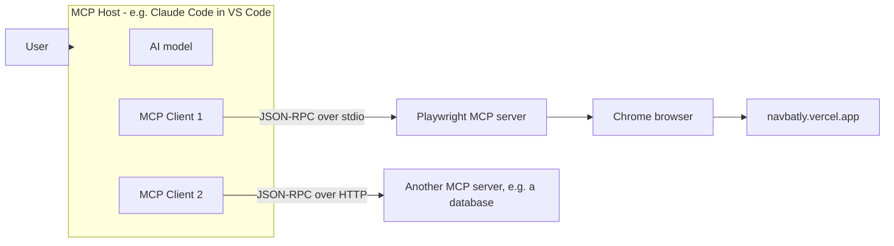

# Navbatly — QA Report: MCP and Playwright MCP Browser Testing

|                  |                                                                                        |
| ---------------- | -------------------------------------------------------------------------------------- |
| **Application**  | Navbatly — online appointment booking for barbershops and beauty salons (Uzbekistan)   |
| **Tested build** | Production, https://navbatly.vercel.app — Git `main` @ `1353bec` (deployed 2026-11-14) |
| **Test date**    | 2026-11-22, final run 10:06:43–10:08:51 UTC (213 MCP tool calls)                       |
| **Test tool**    | Official Microsoft Playwright MCP server `@playwright/mcp@0.0.84`                      |
| **Result**       | **20 PASS · 2 FAIL · 0 BLOCKED · 3 NOT TESTED** (25 test cases) — 1 bug found          |

Raw results: [`qa-results.json`](qa-results.json) · Screenshots: [`screenshots/`](screenshots/) ·
Test scripts: [`mcp-client.mjs`](mcp-client.mjs), [`mcp-handshake.mjs`](mcp-handshake.mjs), [`run-qa.mjs`](run-qa.mjs)

---

## 1. Project overview

Navbatly lets a customer book a haircut in under a minute from a salon's link (shared on
Instagram or Telegram) without creating an account. The salon owner manages services, barbers,
working hours, days off, photos and bookings in an admin panel and receives a Telegram message
for every new booking. The interface is in Uzbek (Latin).

| Part           | Technology (from `package.json`, `README.md`, `vite.config.ts`)                                                         |
| -------------- | ----------------------------------------------------------------------------------------------------------------------- |
| Frontend       | React 19 + TypeScript, Vite 8, React Router, TanStack Query, react-hook-form + zod, Tailwind CSS 4 + shadcn/ui, i18next |
| Backend        | Supabase: PostgreSQL with Row Level Security, Auth, Storage, Edge Functions (Deno)                                      |
| Integrations   | Telegram Bot API + Telegram Mini App, Cloudflare Turnstile (captcha, currently switched off)                            |
| Hosting        | Vercel (frontend), Supabase cloud (database, functions, storage)                                                        |
| Existing tests | 173 component/unit tests (Vitest), 218 database tests (pgTAP), live-site smoke check                                    |

**Routes** (from `src/app/router.tsx`):

| Route                                                              | Purpose                                                    | Login   |
| ------------------------------------------------------------------ | ---------------------------------------------------------- | ------- |
| `/`                                                                | Landing page for salon owners                              | no      |
| `/b/:slug`                                                         | A salon's page and 4-step booking wizard (demo: `/b/demo`) | no      |
| `/privacy`                                                         | Privacy policy                                             | no      |
| `/admin/login`, `/admin/forgot-password`, `/admin/reset-password`  | Sign-in pages                                              | no      |
| `/admin/appointments`, `calendar`, `services`, `staff`, `settings` | Admin panel                                                | **yes** |
| anything else                                                      | "Sahifa topilmadi" (page not found)                        | no      |

**Main booking workflow:** service → barber → day and free time → name, phone, consent →
"Band qilish" (Book) → confirmation. Free times are calculated by the database; the booking
request goes to the `create-booking` Edge Function, which re-checks every rule.

**How to start locally:** `npm install`, copy `.env.example` to `.env.local` and fill in the
Supabase URL and publishable key, then `npm run dev` (http://localhost:5173). For this report
the **deployed production site** was tested instead, because it is what real users and the
assessor see, and it needs no local secrets.

---

## 2. What MCP is and how it works

### 2.1 Definition

The **Model Context Protocol (MCP)** is an open standard, introduced by Anthropic in November
2024, that defines one common way for AI applications to connect to external tools and data —
for example a browser, a database, GitHub or a design tool. A popular comparison is a
"USB-C port for AI": any MCP-compatible assistant can use any MCP server without custom glue
code.

### 2.2 Why MCP was developed

Before MCP, every AI assistant needed its own custom integration for every tool. With _N_
assistants and _M_ tools that is _N × M_ integrations, each with its own format, error handling
and security rules. MCP turns this into _N + M_: each assistant implements the client side of
the protocol once, each tool implements the server side once, and they all work together. It
also gives a single, consistent place for permissions and user consent.

### 2.3 Architecture: Host, Client, Server



| Role       | What it is                                                                                                               | In this project                                       |
| ---------- | ------------------------------------------------------------------------------------------------------------------------ | ----------------------------------------------------- |
| **Host**   | The AI application the user works in. It runs the model, decides which tools may be used, and asks the user for consent. | Claude Code (VS Code extension)                       |
| **Client** | A connector inside the host. Each client keeps **one** session with **one** server.                                      | One client per configured server (here: `playwright`) |
| **Server** | A program that exposes capabilities through MCP.                                                                         | `@playwright/mcp` — controls a real Chrome browser    |

### 2.4 How the communication works

- **Message format:** JSON-RPC 2.0 (requests with an `id`, responses, and one-way notifications).
- **Transports:** _stdio_ — the host starts the server as a local process and exchanges
  newline-separated JSON over its standard input/output (used here); or _Streamable HTTP_ for
  remote servers.
- **Lifecycle:**
  1. `initialize` — client and server agree on a protocol version and announce their capabilities.
  2. `notifications/initialized` — the client confirms; the session is ready.
  3. Discovery — e.g. `tools/list` returns every tool with a name, description and JSON Schema for its inputs.
  4. Use — e.g. `tools/call` runs a tool; the result comes back as content (text, images).
  5. Shutdown — the client closes the connection / process.

Real messages from this test run (shortened):

```json
→ {"jsonrpc":"2.0","id":1,"method":"initialize","params":{"protocolVersion":"2025-06-18","capabilities":{},"clientInfo":{"name":"navbatly-qa-client","version":"1.0.0"}}}
← {"jsonrpc":"2.0","id":1,"result":{"protocolVersion":"2025-06-18","capabilities":{"tools":{}},"serverInfo":{"name":"Playwright","version":"1.65.0-alpha-2026-10-30"}}}
→ {"jsonrpc":"2.0","method":"notifications/initialized"}
→ {"jsonrpc":"2.0","id":3,"method":"tools/call","params":{"name":"browser_navigate","arguments":{"url":"https://navbatly.vercel.app/"}}}
← {"jsonrpc":"2.0","id":3,"result":{"content":[{"type":"text","text":"### Page\n- Page URL: https://navbatly.vercel.app/\n- Page Title: Navbatly ..."}]}}
```

### 2.5 The three server primitives: Tools, Resources, Prompts

| Primitive     | Who controls it                                                           | What it is                                       | Protocol methods                   | Example                             |
| ------------- | ------------------------------------------------------------------------- | ------------------------------------------------ | ---------------------------------- | ----------------------------------- |
| **Tools**     | the **model** decides when to call them (host asks the user for approval) | Actions with typed inputs that can change things | `tools/list`, `tools/call`         | `browser_click`, `browser_navigate` |
| **Resources** | the **application** decides what to attach                                | Read-only context data identified by a URI       | `resources/list`, `resources/read` | a file, a database schema, a log    |
| **Prompts**   | the **user** picks them (e.g. as slash commands)                          | Reusable message templates with arguments        | `prompts/list`, `prompts/get`      | "review this pull request"          |

Clients can also offer features to servers — for example _roots_ (which folders the server may
use), _sampling_ (the server asks the host's model to generate text) and _elicitation_ (the
server asks the user a question). Playwright MCP 0.0.84 exposes **tools only** (its
`initialize` answer lists the `tools` capability).

### 2.6 How an AI assistant uses an external application through MCP

1. The user asks, for example, "check that the booking form shows an error for an empty phone".
2. The host has already called `tools/list`, so the model knows the browser tools and their inputs.
3. The model chooses a tool, e.g. `browser_navigate` with `{"url": ".../b/demo"}`; the host asks
   the user for permission (unless already allowed) and sends `tools/call` through the client.
4. The server performs the action in Chrome and returns a text result — Playwright MCP returns
   an **accessibility snapshot**: a structured outline of the page (roles, names, element
   references such as `[ref=e23]`) rather than pixels, so the model can act precisely and cheaply.
5. The model reads the result and decides the next step (click `ref=e23`, type into a field,
   take a screenshot) until the task is done, then reports to the user.

### 2.7 Real-world applications

- **Browser automation and testing** — Playwright MCP (this report): end-to-end checks, form
  testing, screenshots, debugging of web apps.
- **Databases** — query data, inspect schemas, run security advisors (this project's developer
  used the Supabase MCP server during development).
- **Deployment and hosting** — read deployment status and logs (e.g. the Vercel MCP server).
- **Source code and collaboration** — GitHub (issues, pull requests), Slack, Jira, Google Drive.
- **Design** — reading designs from Figma and turning them into code.
- **Business systems** — CRMs, payment dashboards, internal company APIs.

---

## 3. Playwright MCP configuration

### 3.1 Checks before configuring

| Check                              | Result (verified)                                                                                                                                           |
| ---------------------------------- | ----------------------------------------------------------------------------------------------------------------------------------------------------------- |
| Node.js installed                  | `v24.22.2` (npm `11.19.1`) — Playwright MCP needs Node 18+                                                                                                  |
| Playwright MCP already configured? | **No** — no `.mcp.json` in the project, no `playwright` entry in the user's Claude Code settings                                                            |
| Official package                   | `@playwright/mcp` on npm, repository `github.com/microsoft/playwright-mcp`                                                                                  |
| Version chosen                     | `0.0.84` (released 2026-10-31). Pinned instead of `@latest` so every run uses the same server; the newest release (0.0.86) was only 4 days old at test time |
| Browser                            | Google Chrome (already installed; `--browser chrome`)                                                                                                       |

### 3.2 Configuration added

One file was added to the project root — **`.mcp.json`** (Claude Code project-scoped MCP
configuration). It contains no secrets:

```json
{
  "mcpServers": {
    "playwright": {
      "command": "cmd",
      "args": ["/c", "npx", "-y", "@playwright/mcp@0.0.84", "--browser", "chrome", "--isolated"]
    }
  }
}
```

- `cmd /c` — on native Windows, servers started with `npx` must be launched through `cmd`.
- `--browser chrome` — use the installed Google Chrome.
- `--isolated` — a fresh in-memory browser profile for every session: no saved logins or
  cookies from the developer's own browser can leak into tests.
- For the automated run, `--headless` and an `--output-dir` in the system temp folder were
  added on the command line (so the server's internal snapshot files do not clutter the project).

No application code, dependency or environment file was changed.

### 3.3 Verification (performed)

`node test-results/mcp-handshake.mjs` starts the server **exactly as written in `.mcp.json`**
and performs the MCP handshake. Output (the tool list is joined onto fewer lines here):

```
server: {"name":"Playwright","version":"1.65.0-alpha-2026-10-30"} | protocol: 2025-06-18
server capabilities: tools
tools (25): browser_close, browser_resize, browser_console_messages, browser_handle_dialog,
  browser_emulate_media, browser_evaluate, browser_file_upload, browser_drop, browser_find,
  browser_fill_form, browser_press_key, browser_type, browser_navigate, browser_navigate_back,
  browser_network_requests, browser_network_request, browser_run_code_unsafe,
  browser_take_screenshot, browser_snapshot, browser_click, browser_drag, browser_hover,
  browser_select_option, browser_tabs, browser_wait_for
```

### 3.4 How the tests were driven — and one limitation

Claude Code loads project MCP servers **when a session starts**, and asks the user once to
approve a new project server. This configuration was created _during_ an already running
session, so the `playwright` tools were not yet in the assistant's own tool list.

To still test through the official server (and not through a different tool), the run uses
[`mcp-client.mjs`](mcp-client.mjs): a small MCP client (about 100 lines, no dependencies) that does
exactly what the host does — starts the configured server over stdio, sends `initialize`,
`tools/list` and then **`tools/call` for every browser action**. Every navigation, click, form
entry, screenshot, console read and network read in this report is a Playwright MCP tool call
(213 in the final run), recorded in [`qa-results.json`](qa-results.json).

**Next step to use the tools interactively in Claude Code:** reload the VS Code window (or
restart Claude Code) in this folder, approve the `playwright` server when asked, and check
`/mcp` — it should show `playwright` as connected. The assistant can then call
`browser_navigate`, `browser_click`, … directly in conversation.

---

## 4. Testing environment

| Item             | Value                                                                                                                                                       |
| ---------------- | ----------------------------------------------------------------------------------------------------------------------------------------------------------- |
| Operating system | Windows 11 Pro (10.0.26100)                                                                                                                                 |
| Runtime          | Node.js 24.22.2, npm 11.19.1                                                                                                                                |
| MCP server       | `@playwright/mcp@0.0.84` (reports Playwright `1.65.0-alpha-2026-10-30`), MCP protocol `2025-06-18`, stdio transport                                         |
| Browser          | Google Chrome, headless, isolated profile                                                                                                                   |
| Target           | https://navbatly.vercel.app (production build of `main` @ `1353bec`)                                                                                        |
| Viewports        | Desktop 1440×900 · Tablet 768×1024 · Tablet landscape 1024×768 · Mobile 390×844                                                                             |
| Test data        | Public demo salon `/b/demo` ("Madara Barbershop", fake data). Test customer "QA Test", phone `+998 90 000 00 99` — used only against a mocked server answer |
| Run command      | `node test-results/run-qa.mjs` (≈2 minutes)                                                                                                                 |

**Data safety measures (verified):**

- No login credentials were used anywhere.
- The only full booking (TC-16) was **intercepted inside the browser** with Playwright's
  `page.route` (via the `browser_run_code_unsafe` tool): the request to `create-booking` was
  answered by a fake "success" response and never reached the server.
- After the run, the database was checked read-only: **0** appointments named "QA Test" or with
  phone `+998900000099`, and **0** appointments of any kind created in the 3 hours before the
  check (a window that covers all test runs).
- All other requests were ordinary page reads (salon data, free times).

---

## 5. Test cases and results

Status meanings: **PASS** — verified working; **FAIL** — verified defect; **BLOCKED** — could
not run because of a dependency; **NOT TESTED** — deliberately not run (reason given).

| ID     | Area           | Test case                                                                      | Status         | Evidence (from the run)                                                                                                                                                                                                                                                              | Screenshot                                                               |
| ------ | -------------- | ------------------------------------------------------------------------------ | -------------- | ------------------------------------------------------------------------------------------------------------------------------------------------------------------------------------------------------------------------------------------------------------------------------------ | ------------------------------------------------------------------------ |
| TC-01  | Homepage       | Homepage loads with title, headline, navigation and CTAs                       | **PASS**       | Title "Navbatly"; h1 "Mijozlar o'zi yozilsin — siz ishingizga e'tibor bering."; 6 sections; header links Qanday ishlaydi · Imkoniyatlar · Boshqaruv paneli · Demoni ko'rish                                                                                                          | `01-homepage.png`, `01b-homepage-full-page.png`                          |
| TC-02  | Navigation     | Header menu links scroll to their sections                                     | **PASS**       | Each link set `#qanday` / `#imkoniyatlar` / `#panel` and the section moved to the top of the window (0 px)                                                                                                                                                                           | —                                                                        |
| TC-02b | Navigation     | After a menu jump the section label is not hidden behind the sticky header     | **PASS**       | Labels at 72–73 px, header ends at 69 px; the label (not the header) is the visible element at that point                                                                                                                                                                            | `02-menu-jump-boshqaruv-paneli.png`                                      |
| TC-03  | Navigation     | All internal links open real pages; external links are well-formed             | **PASS**       | Collected from `/` and `/privacy`: internal `/`, `/b/demo`, `/privacy`, `/admin/login` all opened without "not found"; anchors `#qanday`, `#imkoniyatlar`, `#panel`; external `https://t.me/navbatly_uz_bot?start=demo`, `https://t.me/navbatly_uz_bot` (format checked, not opened) | —                                                                        |
| TC-04  | Navigation     | Hero button "Demo salonni ochish" opens the demo salon                         | **PASS**       | Click → `/b/demo`, step 1 "Xizmatni tanlang" shown                                                                                                                                                                                                                                   | —                                                                        |
| TC-05  | Navigation     | Privacy page shows all sections and links back home                            | **PASS**       | h1 "Maxfiylik siyosati", 6 sections, "Bosh sahifa" link → `/`                                                                                                                                                                                                                        | —                                                                        |
| TC-06  | Navigation     | Unknown page and unknown salon show friendly "not found" pages                 | **PASS**       | `/this-page-does-not-exist` → "Sahifa topilmadi"; `/b/no-such-salon-qa` → "Salon topilmadi"                                                                                                                                                                                          | `10-not-found-page.png`                                                  |
| TC-07  | Security       | Admin pages require login                                                      | **PASS**       | Logged-out visit to `/admin/appointments` redirected to `/admin/login`                                                                                                                                                                                                               | —                                                                        |
| TC-08  | Forms          | Admin login: empty and invalid email rejected before any request               | **PASS**       | Empty → "Emailni kiriting." + "Parolni kiriting."; `not-an-email` → "Email noto'g'ri ko'rinishda"; no request to `/auth/v1/token`                                                                                                                                                    | `09-admin-login-validation.png`                                          |
| TC-09  | Barbershops    | Barbershop listing page                                                        | **NOT TESTED** | The feature does not exist: each salon shares its own link `/b/<slug>`; the router has no listing route; a public catalog is planned (Phase 3 in `docs/ARCHITECTURE.md`). The salon page was tested instead (TC-10)                                                                  | —                                                                        |
| TC-10  | Barbershops    | Salon page (desktop): name, address, hours, barbers, gallery                   | **PASS**       | "Madara Barbershop"; Mon–Sat 09:00–20:00, Sunday "Dam olish kuni" (marked "Bugun" — the test ran on a Sunday); barbers Jasur, Bobur, Akmal; 8 gallery photos; call link present                                                                                                      | `03-barbershop-details.png`, `03b-barbershop-details-full-page.png`      |
| TC-11  | Barbershops    | Services show name, duration and price matching the API                        | **PASS**       | The page's 5 services were compared with the API response captured during page load: Soch olish 80 000 so'm / 30 daq; Soqol olish 50 000 / 20; Soch + soqol 120 000 / 50; Bolalar soch turmagi 60 000 / 30; Ukladka 40 000 / 20 — all match                                          | `03-barbershop-details.png`                                              |
| TC-12  | Booking        | Step 1 → 2: "Davom etish" disabled until a service is chosen; barbers filtered | **PASS**       | Button disabled before selection; "Soch olish" → 3 barbers, each with "Eng yaqin" (nearest free time)                                                                                                                                                                                | `04a-booking-barber-step.png`                                            |
| TC-13  | Booking        | Step 2 → 3 → 4: barber, day and free time                                      | **PASS**       | Barber Jasur → 26 free times shown → 10:00 picked → contact form "Ma'lumotlaringiz"                                                                                                                                                                                                  | `04b-booking-time-step.png`, `04-booking-form.png`                       |
| TC-14  | Booking        | Empty form submission                                                          | **PASS**       | Name, phone and consent errors shown; no request to `create-booking` was sent                                                                                                                                                                                                        | `05-form-validation.png`                                                 |
| TC-15  | Booking        | Invalid input: 1-letter name, short phone, letters in phone                    | **PASS**       | Name "A" rejected; typing `abc12345` into the phone field kept only digits ("12 345") and was rejected as too short                                                                                                                                                                  | `05b-form-invalid-input.png`                                             |
| TC-16  | Booking        | Valid booking → confirmation screen (**server answer mocked**)                 | **PASS**       | "So'rovingiz yuborildi!" + "Tasdiqlash kutilmoqda" shown; the intercepted request carried the chosen service, barber, time `2026-11-23T05:00:00+00:00` (10:00 Tashkent), name "QA Test", phone `+998900000099` and an empty honeypot field; nothing was saved                        | `06-booking-confirmation.png`                                            |
| TC-17  | Responsive     | Desktop 1440×900                                                               | **PASS**       | No sideways scrolling (0 px); salon page in two columns (info + booking card)                                                                                                                                                                                                        | `07-desktop-homepage.png`, `07-desktop-salon-page.png`                   |
| TC-17  | Responsive     | Tablet 768×1024                                                                | **FAIL**       | Homepage scrolls sideways by **16 px** (salon page 0 px, single column as designed) — see BUG-01                                                                                                                                                                                     | `07-tablet-homepage.png`, `07-tablet-salon-page.png`                     |
| TC-17  | Responsive     | Tablet landscape 1024×768                                                      | **FAIL**       | Homepage scrolls sideways by **27 px** (salon page 0 px, two columns) — see BUG-01                                                                                                                                                                                                   | `07-tablet-landscape-homepage.png`, `07-tablet-landscape-salon-page.png` |
| TC-17  | Responsive     | Mobile 390×844                                                                 | **PASS**       | 0 px overflow on both pages; salon page single column with sticky bottom bar                                                                                                                                                                                                         | `07-mobile-homepage.png`, `07-mobile-salon-page.png`                     |
| TC-18  | Browser errors | No console errors during the whole session                                     | **PASS**       | `browser_console_messages` (all, level error): "Total messages: 0 (Errors: 0, Warnings: 0)"                                                                                                                                                                                          | —                                                                        |
| TC-19  | Browser errors | No failed network requests on clean page loads                                 | **PASS**       | `/` 13, `/b/demo` 26, `/privacy` 7, `/admin/login` 7 requests — none with 4xx/5xx or network error (see note)                                                                                                                                                                        | —                                                                        |
| TC-20  | Admin          | Admin panel after login                                                        | **NOT TESTED** | Requires owner credentials; per the assignment rules none were used. See "supporting evidence" below                                                                                                                                                                                 | —                                                                        |
| TC-21  | Telegram       | Telegram bot and Mini App booking                                              | **NOT TESTED** | Needs the Telegram app and a real account; Playwright cannot drive it. Bot link formats were checked in TC-03                                                                                                                                                                        | —                                                                        |

**Note on TC-19:** over the whole scripted session the browser listed 2 requests as
`net::ERR_ABORTED`. These are requests the browser cancels itself when the test navigates to the
next page while they are still loading — not server or application failures. That is why the
check loads each page cleanly, waits, and checks that page's own requests.

**Supporting evidence for areas Playwright could not reach (not part of the MCP run):** the
project's own automated test suite was run on the same day — `npx vitest run`: **29 files, 173
tests passed**, including 37 tests in the admin-screen test files (bookings list, calendar,
manual booking, services, settings and the Telegram settings card).

---

## 6. Passed tests (20)

TC-01, TC-02, TC-02b, TC-03, TC-04, TC-05, TC-06, TC-07, TC-08, TC-10, TC-11, TC-12, TC-13,
TC-14, TC-15, TC-16, TC-17 desktop, TC-17 mobile, TC-18, TC-19.

## 7. Failed tests (2)

| Test                              | What failed                                                            | Cause  |
| --------------------------------- | ---------------------------------------------------------------------- | ------ |
| TC-17 tablet (768×1024)           | Homepage is 16 px wider than the screen → page can be dragged sideways | BUG-01 |
| TC-17 tablet landscape (1024×768) | Homepage is 27 px wider than the screen                                | BUG-01 |

Blocked: none. Not tested: TC-09 (feature does not exist), TC-20 (needs credentials), TC-21
(needs the Telegram app).

---

## 8. Bugs and recommendations

### BUG-01 — Homepage scrolls sideways on tablets and small laptops

|                        |                                                                                                                                                                                                                                                                                                                                                                                                                                        |
| ---------------------- | -------------------------------------------------------------------------------------------------------------------------------------------------------------------------------------------------------------------------------------------------------------------------------------------------------------------------------------------------------------------------------------------------------------------------------------- |
| **Severity**           | Low–Medium (cosmetic, but noticeable on tablets: the whole page wobbles sideways when swiped)                                                                                                                                                                                                                                                                                                                                          |
| **Where**              | `/` — "Boshqaruv paneli" section (laptop picture of the admin panel)                                                                                                                                                                                                                                                                                                                                                                   |
| **Measured**           | Extra width 16 px at 768 px, 19 px at 820 px, 23 px at 900 px, 27 px at 1024 px; 0 px at 390 px, 1280 px and 1440 px                                                                                                                                                                                                                                                                                                                   |
| **Cause (verified)**   | The laptop's base `div` in `Laptop()` — `src/pages/public/LandingPage.tsx:49`, class `-mx-[5%]` — is deliberately 5 % wider than the laptop on each side. When the laptop is as wide as the page content (between ≈768 and ≈1100 px), that extra 5 % sticks out past the right edge of the screen. It was identified with `browser_evaluate` by listing elements whose right edge is beyond the viewport: this `div` was the only one. |
| **Steps to reproduce** | Open https://navbatly.vercel.app on a 768–1024 px wide screen (e.g. iPad), scroll to "Kunni bir qarashda ko'ring", swipe left                                                                                                                                                                                                                                                                                                          |
| **Recommendation**     | Clip horizontal overflow on that section (e.g. Tailwind `overflow-x-clip` on `<section id="panel">`) or let the base stay inside the laptop's width on narrower screens. Then re-run TC-17. _(Not fixed here — the assignment asked not to modify the application.)_                                                                                                                                                                   |

### Observations (not defects)

| #      | Observation                                                                                                                                                                                                                                | Recommendation                                                                                                        |
| ------ | ------------------------------------------------------------------------------------------------------------------------------------------------------------------------------------------------------------------------------------------ | --------------------------------------------------------------------------------------------------------------------- |
| OBS-01 | After a header menu jump the section label is only 3–4 px below the sticky header (TC-02b): visible, but tight.                                                                                                                            | Add a small `scroll-margin-top` (e.g. Tailwind `scroll-mt-20`) to the sections for more breathing room.               |
| OBS-02 | The captcha (Cloudflare Turnstile) is built in but switched off in production, so automated scripts can reach the booking form. Spam protection currently relies on a hidden honeypot field (verified empty in TC-16) and database limits. | Switch the captcha on (site key in Vercel first, then the secret key in Supabase), as already planned by the project. |
| OBS-03 | There is no public list of barbershops (TC-09).                                                                                                                                                                                            | Expected for the current scope; the planned catalog (Phase 3) would add it.                                           |

---

## 9. Screenshot references

All files are in [`test-results/screenshots/`](screenshots/) and were captured by
`browser_take_screenshot` during the final run. Only tested states were captured (no
`02-barbershop-list.png`: that page does not exist).

| File                                                                     | Shows                                                        | Test         |
| ------------------------------------------------------------------------ | ------------------------------------------------------------ | ------------ |
| `01-homepage.png`                                                        | Homepage, first screen, desktop                              | TC-01        |
| `01b-homepage-full-page.png`                                             | Whole homepage, desktop                                      | TC-01        |
| `02-menu-jump-boshqaruv-paneli.png`                                      | Window after clicking "Boshqaruv paneli" in the header       | TC-02b       |
| `03-barbershop-details.png`                                              | Demo salon page, desktop (cover, hours, barbers, services)   | TC-10, TC-11 |
| `03b-barbershop-details-full-page.png`                                   | Whole demo salon page incl. «Ishlarimiz» gallery             | TC-10        |
| `04a-booking-barber-step.png`                                            | Step 2 — barber choice with nearest free times               | TC-12        |
| `04b-booking-time-step.png`                                              | Step 3 — day and free times, 10:00 selected                  | TC-13        |
| `04-booking-form.png`                                                    | Step 4 — contact form with booking summary                   | TC-13        |
| `05-form-validation.png`                                                 | Empty submission — required-field errors                     | TC-14        |
| `05b-form-invalid-input.png`                                             | Invalid name and phone — errors                              | TC-15        |
| `06-booking-confirmation.png`                                            | Confirmation "So'rovingiz yuborildi!" (mocked server answer) | TC-16        |
| `07-desktop-homepage.png`, `07-desktop-salon-page.png`                   | 1440×900                                                     | TC-17        |
| `07-tablet-homepage.png`, `07-tablet-salon-page.png`                     | 768×1024                                                     | TC-17        |
| `07-tablet-landscape-homepage.png`, `07-tablet-landscape-salon-page.png` | 1024×768                                                     | TC-17        |
| `07-mobile-homepage.png`, `07-mobile-salon-page.png`                     | 390×844                                                      | TC-17        |
| `09-admin-login-validation.png`                                          | Admin login with validation errors                           | TC-08        |
| `10-not-found-page.png`                                                  | "Sahifa topilmadi" page                                      | TC-06        |

A headless browser shows no scrollbar, so BUG-01's sideways overflow is not visible in
`07-tablet-*homepage.png`; it is proven by the measurement in TC-17 and the element found in §8.

---

## 10. Verified results vs. assumptions

**Verified in this run (with evidence above):** every PASS/FAIL in §5; the MCP handshake and
tool list (§3.3); that no test booking reached the database (§4); the cause of BUG-01.

**Not verified here / assumptions:**

- Real booking creation on the server was **not** exercised (by design, to avoid real
  appointments). Its server-side rules are covered by the project's database tests (218 pgTAP
  tests, not re-run for this report) — stated as context, not as a result of this run.
- The admin panel (TC-20) and Telegram (TC-21) were not tested in a browser; the 173 component
  tests are supporting evidence only.
- Tests ran in headless Chrome on Windows. Other browsers (Safari/iOS, Firefox) were not tested.
- Free times depend on the day and on existing bookings; on a day with no free time in the next
  7 days, TC-13 to TC-16 would report **BLOCKED** (the script handles this).

---

## 11. Conclusion

Playwright MCP was configured from the official Microsoft package, verified through a real MCP
handshake (25 browser tools available), and used to run 25 test cases against the production
Navbatly site — 213 MCP tool calls in total.

The core customer journey works end to end: the landing page, navigation, the salon page with
correct services and prices, all four booking steps, required-field and invalid-input
validation, and the confirmation screen. There were **no console errors and no failed network
requests**, logged-out access to the admin panel is correctly blocked, and the desktop and
mobile layouts are correct.

One genuine defect was found — **BUG-01**, the homepage scrolling sideways by 16–27 px on
tablet-sized screens — with its exact cause and a simple fix recommended. Three areas could not
be tested in the browser for clear reasons (no listing feature, no credentials by rule, Telegram
app required).

**How to reproduce:** `node test-results/mcp-handshake.mjs` (configuration check), then
`node test-results/run-qa.mjs` (full run; writes `qa-results.json` and the screenshots).
